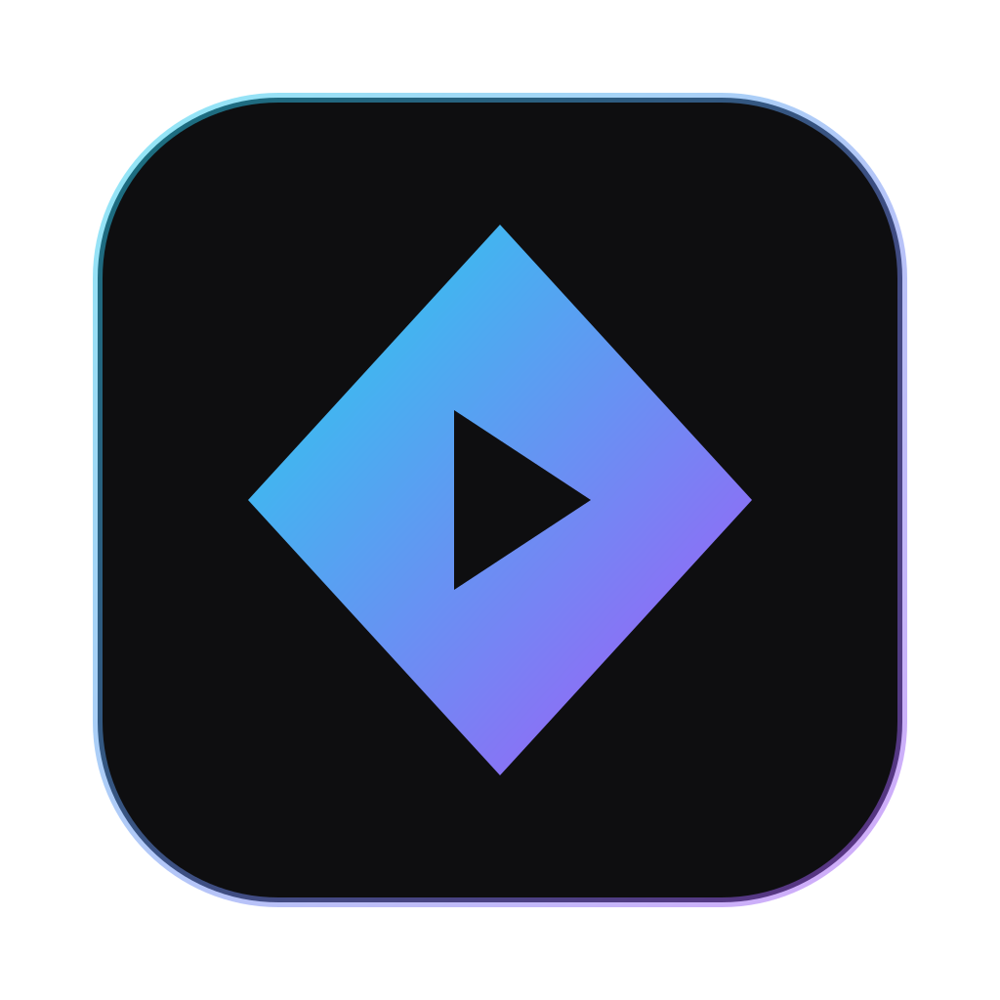
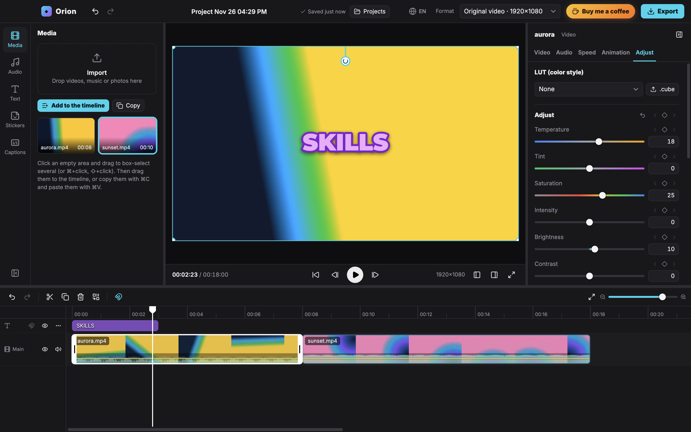

<div align="center">



# Leo

**Editor de vídeo gratis y de código abierto. Sin cuenta, sin marca de agua, sin suscripción.**
Todo —también la IA— funciona en tu ordenador. Tus vídeos no salen de él.

[**Descargar**](https://leoapp.dev) · [**Usarlo en el navegador**](https://leoapp.dev/app/) · [Versiones](https://github.com/rafa794/leo/releases) · [English](README.md)



</div>

## Por qué Leo

- **Gratis de verdad**: todas las funciones, sin marca de agua, sin versión «Pro» y sin registrarte.
- **Privado**: editar, exportar y la IA se hacen en tu equipo. No se sube nada.
- **Funciona en ordenadores normales**: no necesita tarjeta gráfica. Mac, Windows, Linux y Chrome / Edge.
- **Te resultará familiar**: línea de tiempo y paneles como los editores que ya conoces.
- **En tu idioma**: español, English, Français, Português.

## Qué tiene

**Línea de tiempo**
- Pista principal magnética y pistas de vídeo, texto y audio; arrastra un clip por encima de la pista de arriba y se crea una nueva.
- Recortar, cortar, borrar sin huecos, copiar / pegar, duplicar, deshacer / rehacer, selección con recuadro.
- Ocultar pistas (no salen en la exportación), silenciarlas, imán por pista y clips combinados.
- Miniaturas, forma de onda, línea de volumen y vista previa fluida al arrastrar la aguja, incluso en 4K.

**Imagen**
- Posición, escala, giro, voltear, opacidad, modos de fusión, recorte y alineado, directamente en el visor.
- Fotogramas clave en casi todo (transformación, color, volumen, máscara…) y grabación de movimiento al reproducir.
- Color: temperatura, tinte, saturación, exposición, contraste, luces, sombras, viñeta, nitidez, desenfoque,
  LUT incluidos e importación de `.cube`, acelerado por GPU.
- Máscaras (dividir, franja, círculo, rectángulo, estrella, corazón) editables en el visor, con difuminado e invertir.
- Croma, estabilizador (OpenCV), congelar fotograma, revertir y velocidad de 0.1x a 10x.
- Más de 40 animaciones, plantillas de texto y stickers 3D.

**Sonido**
- Música y efectos gratis (CC0 / CC BY) con buscador y créditos en un clic.
- Fundidos, fotogramas clave de volumen y separar el audio.
- Aislar voz y quitar voz con IA (RNNoise), con progreso real.

**IA (local y gratis)**

| Función | Modelo | Notas |
|---|---|---|
| Subtítulos automáticos + `.srt` | OpenAI Whisper con transformers.js | Se descarga una vez (80–800 MB) |
| Quitar fondo | Google MediaPipe Selfie Multiclass | ~16 MB |
| Aislar / quitar voz | RNNoise | Incluido |

**Exportar**
- MP4 (H.264 + AAC) de 720p a 4K, de 24 a 60 fps, en segundo plano mientras sigues editando.
- Todo el vídeo, un clip, una selección o una sola pista.
- Formatos: tamaño original de tus vídeos, 16:9, 9:16, 1:1 y 4:5.

**Proyectos**: se guardan solos y se reabren donde lo dejaste; los vídeos grandes de la cámara se quedan en tus
carpetas y Leo los vuelve a encontrar.

## Descargar

Desde la [web](https://leoapp.dev) o la [última versión](https://github.com/rafa794/leo/releases/latest):

| Sistema | Archivo |
|---|---|
| macOS (Apple Silicon) | `Leo-mac-arm64.dmg` |
| macOS (Intel) | `Leo-mac-x64.dmg` |
| Windows (instalador) | `Leo-Setup-x64.exe` · `Leo-Setup-arm64.exe` |
| Windows (portable) | `Leo-Portable.exe` |
| Linux | `Leo-linux-x86_64.AppImage` · `.deb` |
| Android 7 o superior | `Leo-android.apk` (permite instalar apps de este origen cuando lo pida) |

> Las apps aún no están firmadas con certificados de pago.
> **macOS:** la primera vez, clic derecho sobre Leo en Aplicaciones → *Abrir* → *Abrir*.
> **Windows:** en el aviso de SmartScreen pulsa *Más información* → *Ejecutar de todas formas*.

O úsalo sin instalar nada [en el navegador](https://leoapp.dev/app/) (mejor en Chrome o Edge).

## Compilar desde el código

Necesitas Node.js 22 o superior.

```bash
git clone https://github.com/rafa794/leo.git
cd orion
npm install
npm run dev            # versión navegador en http://localhost:5173
```

| Comando | Qué hace |
|---|---|
| `npm run mac` | Abre la app de escritorio (Electron) |
| `npm run mac:build` | Crea `release/mac-*/Leo.app` |
| `npm run dist:mac` / `dist:win` / `dist:linux` | Instaladores de cada sistema |
| `npm run site:build` | Web + versión navegador (`site-dist/`, para Cloudflare Pages) |
| `npm run android:release` | APK de Android firmado (Capacitor, necesita Java 21 y el SDK de Android) |
| `npm run android:live` | Recarga en directo en un móvil conectado por USB (instala una app aparte, «Leo Dev») |

### Desarrollar en un móvil Android

Activa *Opciones de desarrollador → Depuración USB* en el móvil, conéctalo por cable, acepta el aviso y ejecuta
`npm run android:live`. Instala **Leo Dev** junto a la app normal y carga el editor desde tu ordenador por el
cable: cada cambio en el código aparece en el móvil al momento. Chrome → `chrome://inspect` muestra la consola
del móvil. Si desconectas el cable, vuelve a ejecutar el comando.

## Tests

```bash
npm test               # tests unitarios (Vitest)
npm run test:app       # de principio a fin sobre la app real (Playwright + Electron)
npm run test:mac-app   # lo mismo, sobre Leo.app empaquetada
```

Los tests de la app usan un perfil temporal: nunca tocan tus proyectos.

## Traducciones

El español es el texto original y la clave de cada traducción (`src/i18n/{en,fr,pt}.json`). Si añades textos,
ejecuta `node scripts/i18n-extract.mjs` y añade las claves nuevas a cada idioma. ¡Se aceptan idiomas nuevos!

## Colaborar

Issues y pull requests son bienvenidos: fallos, ideas, traducciones. Ejecuta `npm test` y `npm run test:app`
antes de abrir un PR. También puedes enviar sugerencias desde la app (*Ayuda → Enviar una sugerencia*).

## Apoyar el proyecto

Leo es gratis y lo seguirá siendo. Si te ayuda, puedes invitarme a un café desde la app
(*Leo → Acerca de Leo · Invítame a un café*). ¡Gracias!

## Licencia

[GPL-3.0](LICENSE): puedes usar, estudiar, compartir y modificar Leo; si distribuyes una versión modificada,
debe seguir siendo de código abierto con la misma licencia. Las librerías, modelos y recursos de terceros
mantienen sus licencias: mira *Ayuda → Licencias y créditos* en la app.
