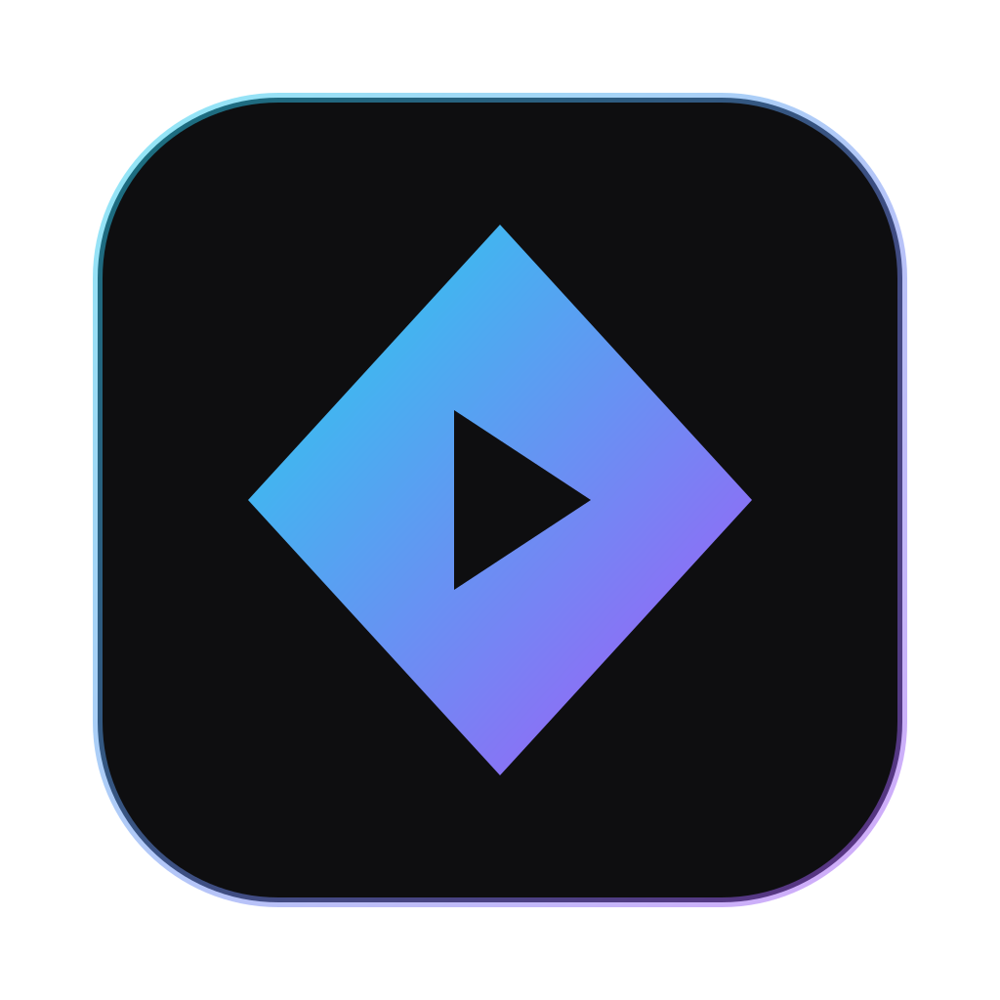
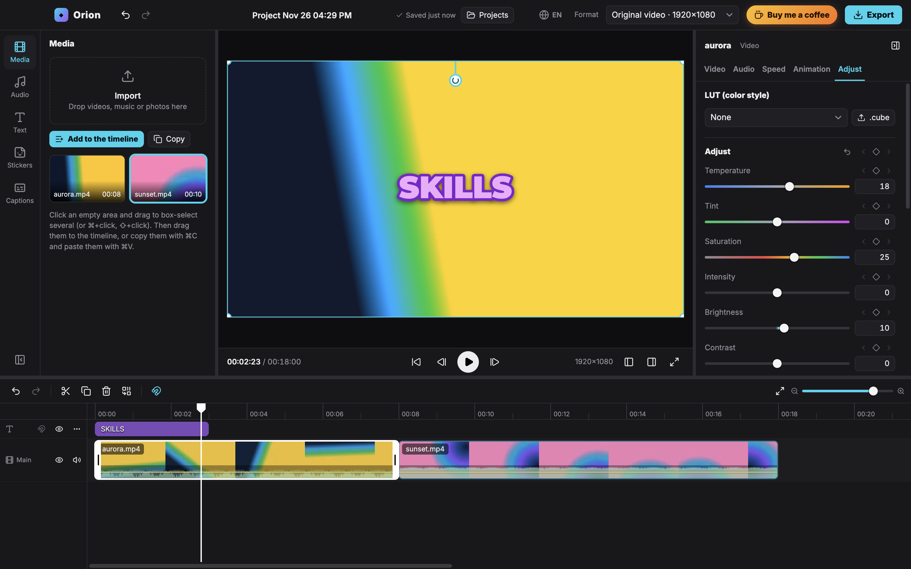

<div align="center">



# Leo

**A free, open-source video editor. No account, no watermark, no subscription.**
Everything — AI included — runs on your own computer. Your videos never leave it.

[**Download**](https://leo.rafael-mendoza.com) · [**Use it in the browser**](https://leo.rafael-mendoza.com/app/) · [Releases](https://github.com/rafa794/leo/releases) · [Español](README.es.md)



</div>

## Why Leo

- **Free for real** — every feature, no watermark, no "Pro" tier, no sign-up.
- **Private** — editing, exporting and the AI run locally. Nothing is uploaded.
- **Runs on normal computers** — no graphics card needed; works on Mac, Windows, Linux and in Chrome / Edge.
- **Familiar** — a timeline and panels that feel like the editors you already know.
- **In your language** — English, Español, Français, Português.

## Features

**Timeline**
- Magnetic main track, overlay / text / audio tracks; drag a clip above the top track to create a new one.
- Trim, split, ripple delete, copy / paste, duplicate, undo / redo, multi-select with a marquee.
- Per-track hide (excluded from export), mute and magnet; compound clips (group, edit inside, ungroup).
- Thumbnails, waveforms, volume lines and smooth real-time scrubbing — even with 4K footage.

**Picture**
- Position, scale, rotation, flip, opacity, blend modes, crop and alignment — directly on the viewer.
- Keyframes on almost everything (transform, color, volume, mask…), with motion recording while playing.
- Color: temperature, tint, saturation, exposure, contrast, highlights, shadows, vignette, sharpen, blur,
  built-in LUTs and `.cube` import — GPU accelerated.
- Masks (split, stripe, circle, rectangle, star, heart) editable on the viewer, feather and invert.
- Chroma key, video stabilization (OpenCV), freeze frame, reverse, speed from 0.1x to 10x.
- 40+ in / out / combo animations, text templates, 3D stickers.

**Sound**
- Free music and sound effects (CC0 / CC BY) with search and one-click credits.
- Fades, volume keyframes, detach audio.
- AI voice isolation and voice removal (RNNoise), with real progress.

**AI (local and free)**

| Feature | Model | Notes |
|---|---|---|
| Automatic subtitles + `.srt` | OpenAI Whisper via transformers.js | Downloaded once (80–800 MB) |
| Background removal | Google MediaPipe Selfie Multiclass | ~16 MB |
| Voice isolation / removal | RNNoise | Included |

**Export**
- MP4 (H.264 + AAC) from 720p to 4K, 24–60 fps, in the background while you keep editing.
- Export the whole video, a single clip, a selection or a single track.
- Formats: original size of your footage, 16:9, 9:16, 1:1, 4:5.

**Projects** save themselves as you edit and reopen where you left them; large camera files stay in your folders
and are found again automatically.

## Download

Get the latest version from the [website](https://leo.rafael-mendoza.com) or the [releases page](https://github.com/rafa794/leo/releases/latest):

| System | File |
|---|---|
| macOS (Apple Silicon) | `Leo-mac-arm64.dmg` |
| macOS (Intel) | `Leo-mac-x64.dmg` |
| Windows (installer) | `Leo-Setup-x64.exe` · `Leo-Setup-arm64.exe` |
| Windows (portable) | `Leo-Portable.exe` |
| Linux | `Leo-linux-x86_64.AppImage` · `.deb` |
| Android 7+ | `Leo-android.apk` (allow installing from this source when asked) |

> The apps are not signed with paid certificates yet.
> **macOS:** the first time, right-click Leo in Applications → *Open* → *Open*.
> **Windows:** on the SmartScreen notice click *More info* → *Run anyway*.

Or skip installing and [open it in your browser](https://leo.rafael-mendoza.com/app/) (Chrome or Edge recommended).

## Build from source

Requirements: Node.js 22+.

```bash
git clone https://github.com/rafa794/leo.git
cd orion
npm install
npm run dev            # browser version at http://localhost:5173
```

| Command | What it does |
|---|---|
| `npm run mac` | Run the desktop app (Electron) |
| `npm run mac:build` | Build `release/mac-*/Leo.app` |
| `npm run dist:mac` / `dist:win` / `dist:linux` | Installers for each system |
| `npm run site:build` | Website + web app (`site-dist/`, for Cloudflare Pages) |
| `npm run android:release` | Signed Android APK (Capacitor, needs Java 21 + Android SDK) |
| `npm run android:live` | Live reload on a phone plugged in by USB (installs a separate "Leo Dev" app) |

### Developing on an Android phone

Turn on *Developer options → USB debugging* on the phone, plug it in, accept the prompt, then run
`npm run android:live`. It installs **Leo Dev** next to the normal app and loads the editor from your
computer through the cable, so every code change appears on the phone right away. Chrome → `chrome://inspect`
shows the phone's console. If you unplug the cable, run the command again.

## Tests

```bash
npm test               # unit tests (Vitest): keyframes, timeline, export, stabilizer…
npm run test:app       # end-to-end on the real desktop app (Playwright + Electron)
npm run test:mac-app   # the same, on the packaged Leo.app
```

App tests use a throwaway profile, so they never touch your projects.

## How it's built

React 19 + TypeScript + Vite · Zustand · [mediabunny](https://mediabunny.dev) (WebCodecs decode / encode) ·
WebGL2 color pipeline · OpenCV.js · transformers.js · MediaPipe · RNNoise · Electron · Capacitor.

```
src/
  store/        project state, tracks, clips, undo / redo, layout
  lib/          render, player, exporter, keyframes, stabilizer, projects, audio mix…
  ai/           Whisper, MediaPipe, RNNoise and OpenCV workers
  components/   the interface
  i18n/         translations (Spanish is the source text)
electron/       desktop app
functions/      Cloudflare Pages function for the web version
website/        leo.rafael-mendoza.com
tests/          unit and end-to-end tests
```

### Translations

Spanish is the source text and the key of every translation (`src/i18n/{en,fr,pt}.json`).
After adding UI text, run `node scripts/i18n-extract.mjs` and add the new keys to each language.
New languages are welcome.

## Contributing

Issues and pull requests are welcome — bugs, ideas, translations. Please run `npm test` and `npm run test:app`
before opening a PR. Suggestions can also be sent from inside the app (*Help → Send a suggestion*).

## Support the project

Leo is free and will stay free. If it helps you, you can buy me a coffee ☕ — from the app
(*Leo → About Leo · Buy me a coffee*) or right here:

- [PayPal](https://paypal.me/rafaLeoM794)
- [Card · Google Pay · Apple Pay](https://buy.stripe.com/bJe3cx8XC5Au4XR7OIb7y04) (you choose the amount)

Thank you!

## License

[GPL-3.0](LICENSE). You can use, study, share and modify Leo; if you distribute a modified version, it must
stay open source under the same license. Third-party libraries, models and assets keep their own licenses —
see *Help → Licenses and credits* in the app.
